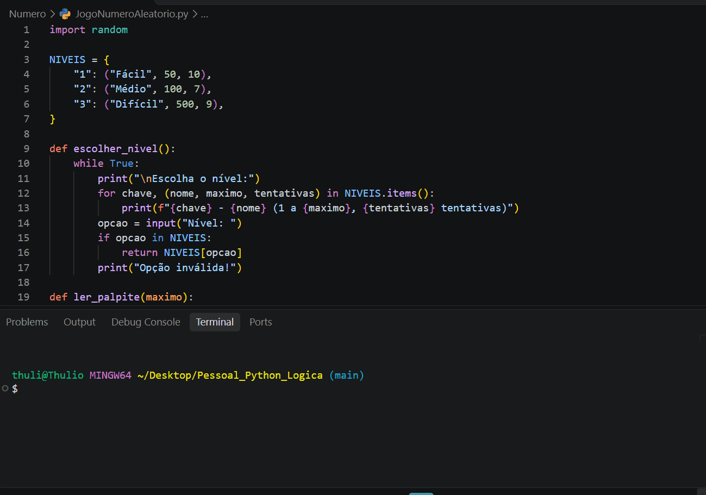

# 🎯 Jogo da Adivinhação

Jogo de adivinhação de número feito em **Python**, rodando no terminal. O computador sorteia um número e você tenta descobrir qual é, recebendo dicas de "mais" ou "menos" a cada palpite.



## 🎮 Funcionalidades

- 🎲 Número sorteado aleatoriamente com a biblioteca `random`
- 📊 3 níveis de dificuldade (fácil, médio e difícil), cada um com limite de tentativas
- 🔢 Contador de tentativas
- 🛡️ Tratamento de erros: o jogo não quebra se você digitar uma letra ou um número fora do intervalo
- 🏆 Recorde da sessão (menor número de tentativas)
- 🔁 Opção de jogar novamente sem fechar o programa

## 🛠️ Tecnologias

- Python 3

## ▶️ Como executar

```bash
git clone https://github.com/Thuliofj/jogo-da-adivinhacao.git
cd jogo-da-adivinhacao
python numeroaleatorio.py
```

## 📚 O que pratiquei

- Estruturas de repetição (`while` e `for`)
- Condicionais (`if`, `elif`, `else`)
- Tratamento de exceções (`try/except`)
- Funções e organização de código
- Dicionários

## 🚀 Próximos passos

- [ ] Salvar o ranking em arquivo
- [ ] Criar uma interface gráfica
- [ ] Modo para dois jogadores

## 👤 Autor

**Thúlio Ferreira Jacauna**
[LinkedIn](#) • [GitHub](https://github.com/Thuliofj)